# ambientCG: Ground materials

**20 assets from [ambientCG](https://ambientcg.com), dedicated to the public domain under [CC0](https://docs.ambientcg.com/license/).** Use them in any game, free or paid, and change them however you like; no credit is needed.

PBR materials as 1K and 2K JPG maps (colour, normal GL and DX, roughness, AO, displacement), one folder per resolution. 853.0 MB in all.

This is a copy kept by [zuujis-cc0](https://github.com/zuujis-cc0) so game makers can take single files from GitHub. It is not made by or affiliated with ambientCG: the originals, often in more formats and higher resolutions, are on [ambientcg.com](https://ambientcg.com). If they help you, consider [supporting ambientCG](https://www.patreon.com/ambientCG).

Every file is listed in [MANIFEST.tsv](MANIFEST.tsv) with its size and SHA-256. More free assets: [the Zuujis collection](https://github.com/zuujis-cc0/free-game-assets#readme).

| | | | |
| :-: | :-: | :-: | :-: |
| <a href="Ground063">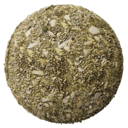</a> <b><a href="Ground063">Ground 063</a></b> by ambientCG · <a href="https://ambientcg.com/a/Ground063">source</a> | <a href="Ground064">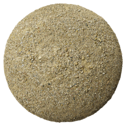</a> <b><a href="Ground064">Ground 064</a></b> by ambientCG · <a href="https://ambientcg.com/a/Ground064">source</a> | <a href="Ground065">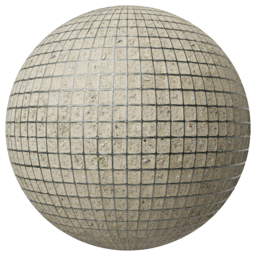</a> <b><a href="Ground065">Ground 065</a></b> by ambientCG · <a href="https://ambientcg.com/a/Ground065">source</a> | <a href="Ground066">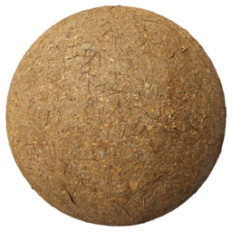</a> <b><a href="Ground066">Ground 066</a></b> by ambientCG · <a href="https://ambientcg.com/a/Ground066">source</a> |
| <a href="Ground067">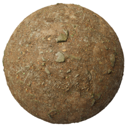</a> <b><a href="Ground067">Ground 067</a></b> by ambientCG · <a href="https://ambientcg.com/a/Ground067">source</a> | <a href="Ground068">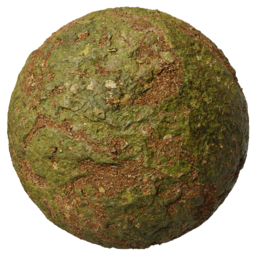</a> <b><a href="Ground068">Ground 068</a></b> by ambientCG · <a href="https://ambientcg.com/a/Ground068">source</a> | <a href="Ground069">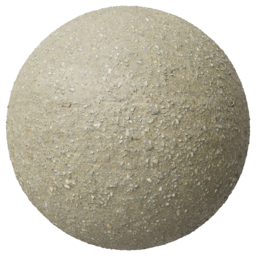</a> <b><a href="Ground069">Ground 069</a></b> by ambientCG · <a href="https://ambientcg.com/a/Ground069">source</a> | <a href="Ground070">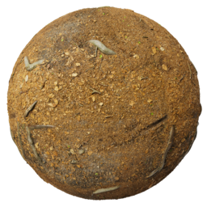</a> <b><a href="Ground070">Ground 070</a></b> by ambientCG · <a href="https://ambientcg.com/a/Ground070">source</a> |
| <a href="Ground071">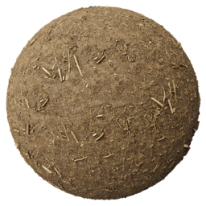</a> <b><a href="Ground071">Ground 071</a></b> by ambientCG · <a href="https://ambientcg.com/a/Ground071">source</a> | <a href="Ground072">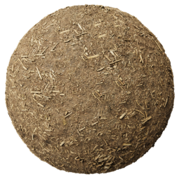</a> <b><a href="Ground072">Ground 072</a></b> by ambientCG · <a href="https://ambientcg.com/a/Ground072">source</a> | <a href="Ground073">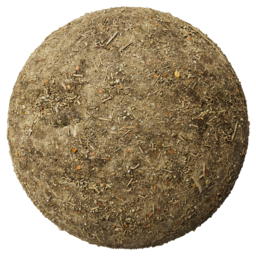</a> <b><a href="Ground073">Ground 073</a></b> by ambientCG · <a href="https://ambientcg.com/a/Ground073">source</a> | <a href="Ground074">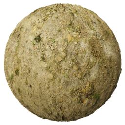</a> <b><a href="Ground074">Ground 074</a></b> by ambientCG · <a href="https://ambientcg.com/a/Ground074">source</a> |
| <a href="Ground075">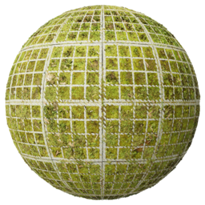</a> <b><a href="Ground075">Ground 075</a></b> by ambientCG · <a href="https://ambientcg.com/a/Ground075">source</a> | <a href="Ground076">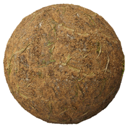</a> <b><a href="Ground076">Ground 076</a></b> by ambientCG · <a href="https://ambientcg.com/a/Ground076">source</a> | <a href="Ground077">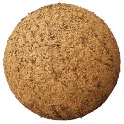</a> <b><a href="Ground077">Ground 077</a></b> by ambientCG · <a href="https://ambientcg.com/a/Ground077">source</a> | <a href="Ground078">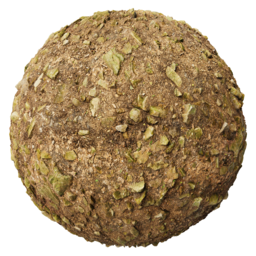</a> <b><a href="Ground078">Ground 078</a></b> by ambientCG · <a href="https://ambientcg.com/a/Ground078">source</a> |
| <a href="Ground079L">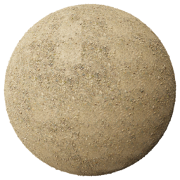</a> <b><a href="Ground079L">Ground 079 L</a></b> by ambientCG · <a href="https://ambientcg.com/a/Ground079L">source</a> | <a href="Ground079S">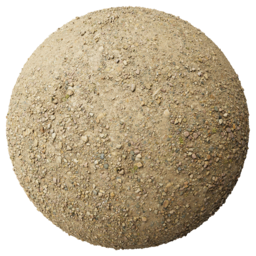</a> <b><a href="Ground079S">Ground 079 S</a></b> by ambientCG · <a href="https://ambientcg.com/a/Ground079S">source</a> | <a href="Ground080">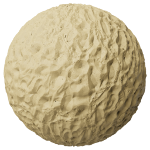</a> <b><a href="Ground080">Ground 080</a></b> by ambientCG · <a href="https://ambientcg.com/a/Ground080">source</a> | <a href="Ground081">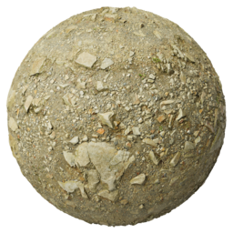</a> <b><a href="Ground081">Ground 081</a></b> by ambientCG · <a href="https://ambientcg.com/a/Ground081">source</a> |

---

Kept up to date by this repository's own [update workflow](.github/workflows/update.yml), with code and plan from [cc0-mirror](https://github.com/zuujis-cc0/cc0-mirror). Something wrong? [Open an issue there](https://github.com/zuujis-cc0/cc0-mirror/issues/new) or use the [private report form](https://games.zuujis.com/report).
